<div align="center">

# FairPlay

### Transparent, fully-collateralised sports betting on Ethereum

**Every bet, every locked price, every payout is an on-chain record that anyone can verify.**

[](https://github.com/pranay123-stack/fairplay-onchain-sportsbook/actions/workflows/ci.yml)


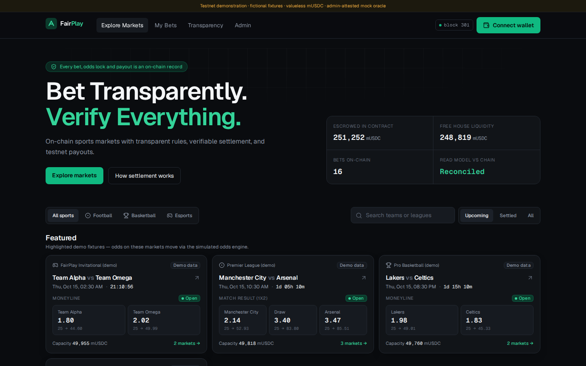

</div>

> **What this is — stated plainly.** FairPlay is a working **demonstration MVP** that runs on a **local Ethereum
> chain (Anvil) with valueless test tokens (mUSDC)**, **fictional fixtures**, and an **admin-controlled mock
> oracle**. It is not real-money gambling, has **not been externally audited**, and is **not deployed to a public
> network** (a Sepolia deployment path is built and rehearsed on a local Sepolia fork — see
> [SEPOLIA_DEPLOYMENT.md](docs/SEPOLIA_DEPLOYMENT.md)).

---

## Why it matters

Traditional sportsbooks ask users to trust a private ledger: you cannot see whether the house can actually pay
every winner, whether your odds were honoured, or how a market was settled. FairPlay moves those guarantees into
code:

| Problem in a traditional book | How FairPlay handles it |
|---|---|
| "Can the house pay if everyone wins?" | Every bet **reserves the house's worst-case loss before it is accepted**; reserved capital can never be withdrawn. Solvency is a public view function. |
| "Did I get the price I clicked?" | Odds are **locked into the bet on-chain**; a stale price makes the transaction revert instead of filling worse. |
| "Who decided the result, and when?" | Results arrive only through a **role-gated oracle adapter**, after betting closed, with a **dispute window** — every report is a public event with reporter and timestamp. |
| "Was my payout calculated correctly?" | Integer-only maths in the contract; the UI shows values **decoded from the transaction receipt**, never computed by the page. |
| "Is the website showing the truth?" | The database is a **rebuildable read model**, continuously **reconciled against the contracts** and re-indexed after chain reorganisations. |

## Highlights

- **Solvent-by-construction fixed-odds engine** — per-market worst-case reservation `max(0, maxᵢ Gᵢ − S)` with
  cross-outcome netting, a global coverage invariant, and fuzz/invariant tests that settle *every* market at its
  worst outcome from random states and pay *every* claim.
- **Security review that found real bugs** — the invariant suite caught two fund-lock bugs and a review found a
  pre-filed-oracle griefing vector; all fixed with regression tests ([findings](docs/SECURITY.md)).
- **Production-style indexer** — confirmation depth, idempotent raw-log store, crash-safe resume, **reorg
  detection and rebuild** (tested with a real chain reorg), field-by-field reconciliation.
- **Wallet-native admin security** — SIWE-style sign-in with single-use expiring nonces, **on-chain role
  re-checked on every request**, and per-action signatures for resolving and cancelling markets.
- **Real-time UX** — Socket.IO pushes odds (pending → confirmed), bets, oracle results, settlements and payouts.
- **Verified with real MetaMask** — faucet, exact-amount approval, bet placement, rejection handling and
  on-chain verification, with transaction hashes below.

---

## System architecture

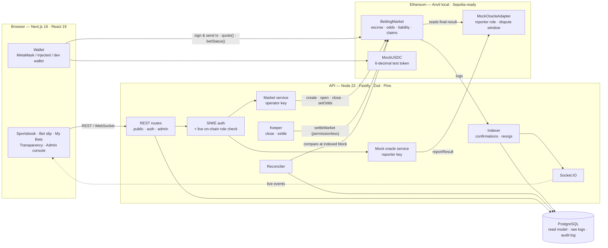

**Trust boundaries:** the contracts hold all value and enforce all money rules. The API holds two role-limited
service keys (it can never move house liquidity or fees). The browser holds no keys at all.

## A bet, end to end

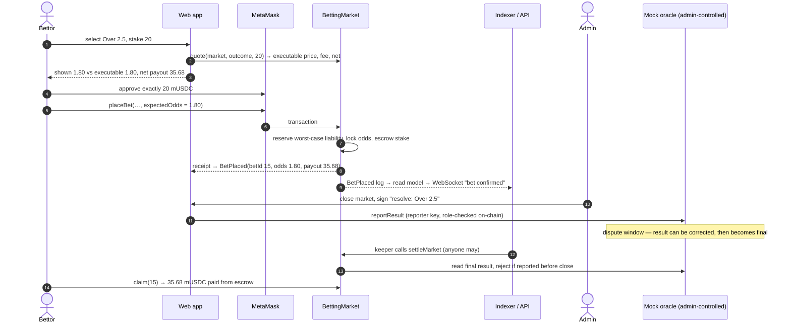

## Market lifecycle

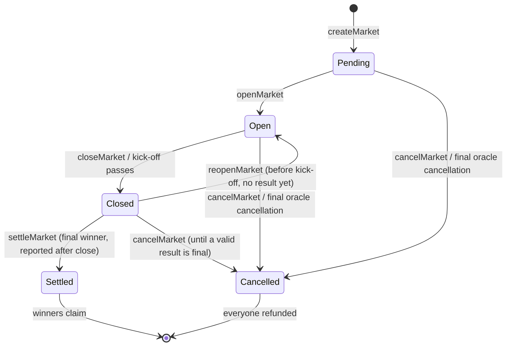

## The solvency model

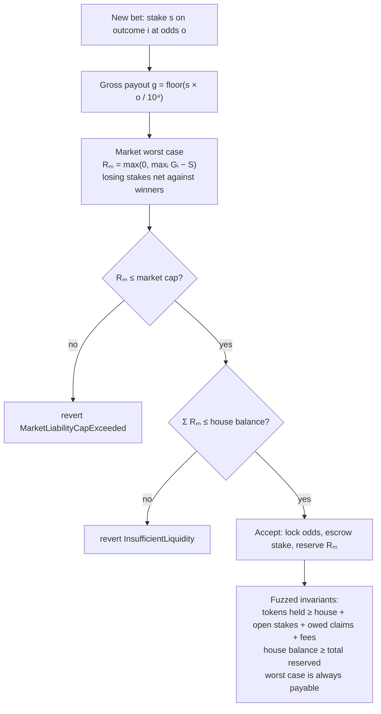

Full derivation and proof sketch: [SMART_CONTRACTS.md](docs/SMART_CONTRACTS.md).

---

## Proof: real MetaMask, real transactions

Recorded on 2026-10-14 with **MetaMask** (account `0x2420…3F30`) against the local FairPlay chain (chain id 31337,
valueless test tokens). Every row was re-checked against the chain with `cast`.

| Step | Transaction | Block | Result |
|---|---|---|---|
| Faucet — `MockUSDC.faucet()` (+1,000 mUSDC) | `0x819791a87457f8a0f9f5e7ad187e199b5c37c5ae8c97701b7bd85accb4a1b84b` | 10097 | ✅ success · 78,904 gas |
| Approve **exactly** 20 mUSDC (no unlimited allowance) | `0xd7b203431f92d6c98b64d4a765de3eea6144f16ee7be209eb11ee15555497b40` | 10229 | ✅ success · 46,360 gas |
| `placeBet` → **Bet #15**, Over 2.5 at **1.8000**, payout **35.68** | `0xcce1748c402458c6a82a46089d710dda8b539b83bd612f2854b08aa90fe492ba` | 10249 | ✅ success · 296,132 gas |
| Second bet **rejected in MetaMask** | — (nothing broadcast) | — | ✅ app shows "You rejected the request in your wallet" |

On-chain state afterwards: `getBet(15)` → bettor `0x24202245Da80c329682E76EA4282426824C03F30`, stake 20.00,
locked odds 1.8000, potential payout 35.68 (= 36 gross − 2 % fee on the 16 profit); `solvency()` → tokens held
**= tokens owed** = 251,443.60 mUSDC.

| | |
|---|---|
| 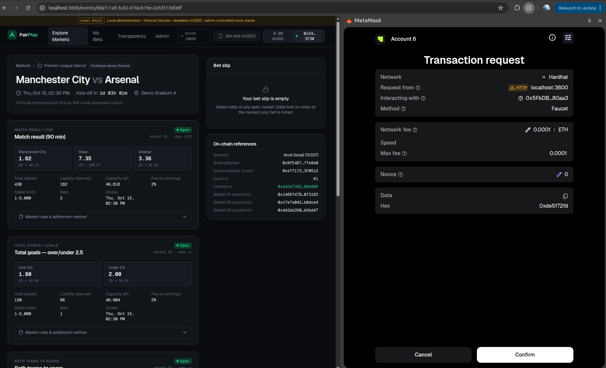<br/>**1.** MetaMask transaction request for the faucet | 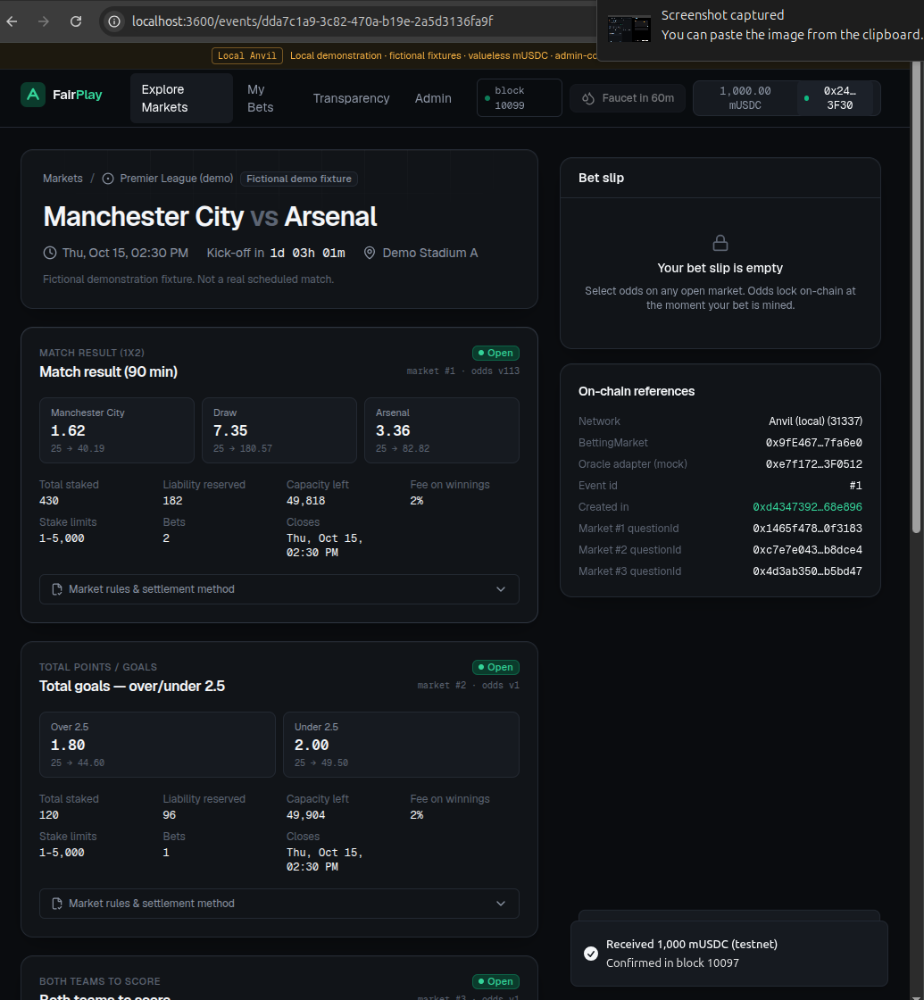<br/>**2.** Confirmed in block 10097; balance read from the chain |
| 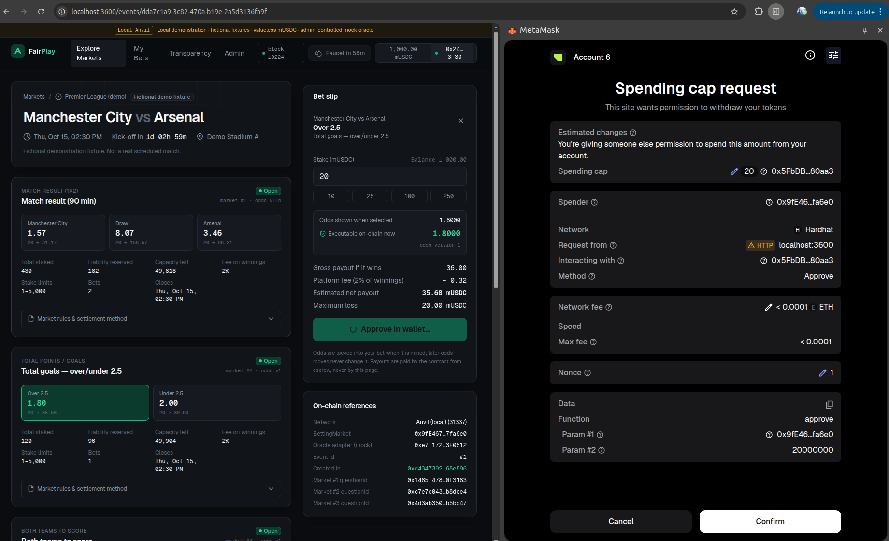<br/>**3.** Spending cap of exactly 20 mUSDC | 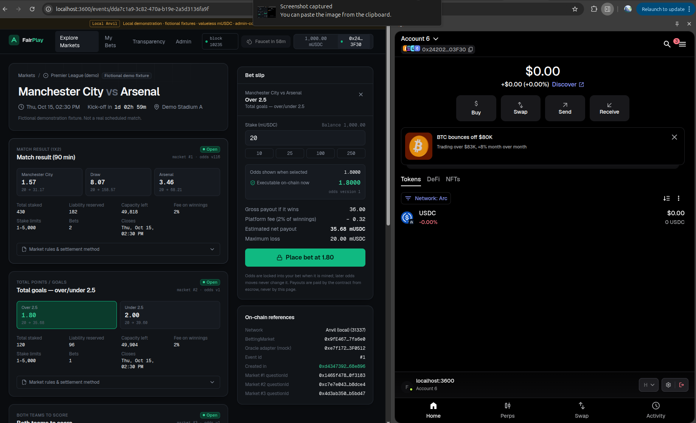<br/>**4.** Bet slip: shown vs executable on-chain odds, fee, net payout, max loss |
| 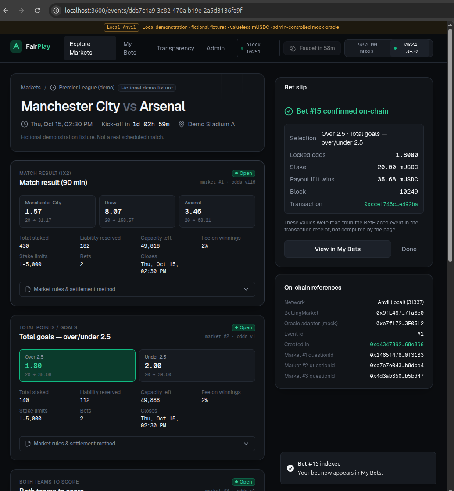<br/>**5.** Bet #15 confirmed — values read from the `BetPlaced` event | 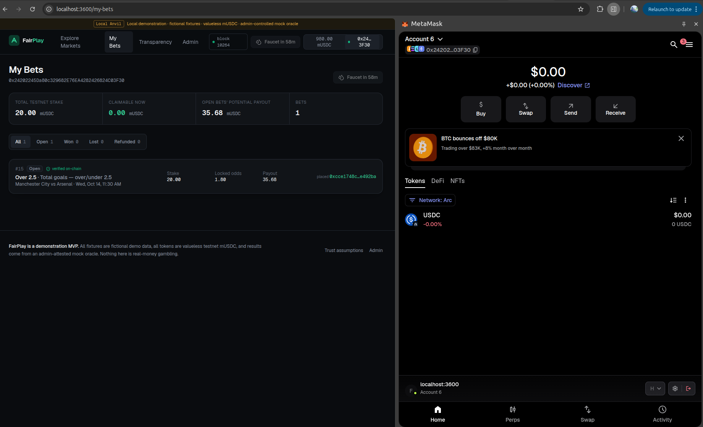<br/>**6.** My Bets — status re-verified with `betStatus()` |
| 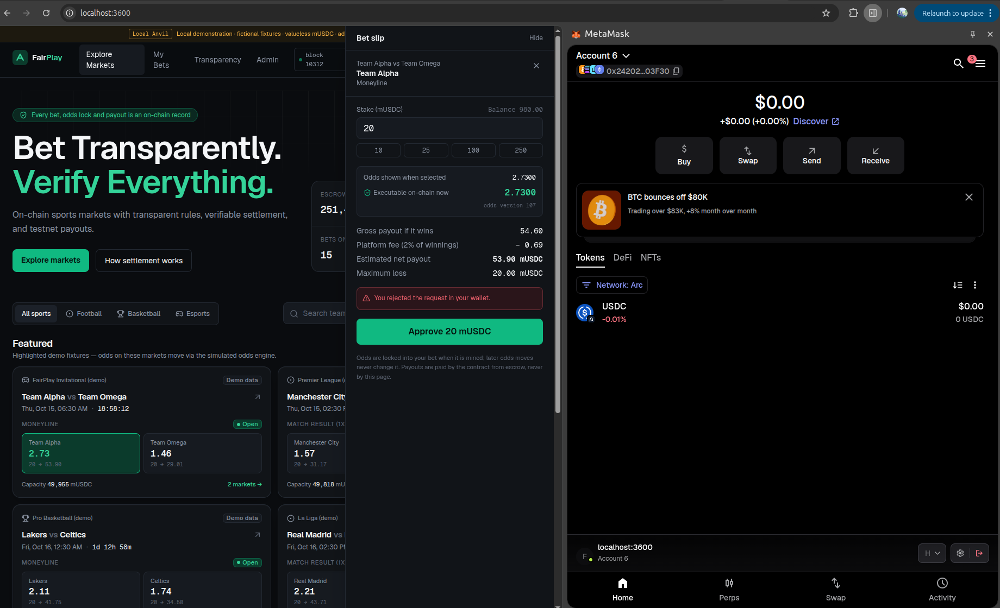<br/>**7.** Rejected in MetaMask — clear error, nothing sent | 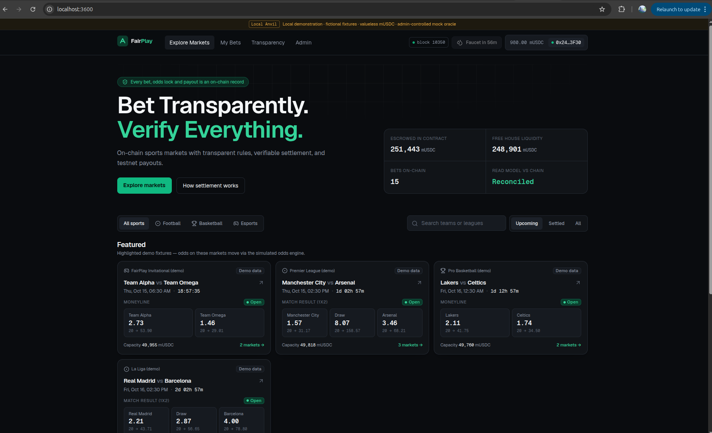<br/>**8.** Sportsbook afterwards — 15 bets on-chain, read model reconciled |

## More screenshots

| | |
|---|---|
| 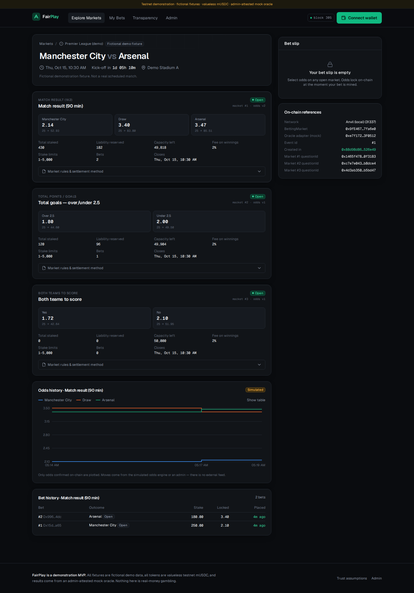 Event detail · simulated odds history · bet history | 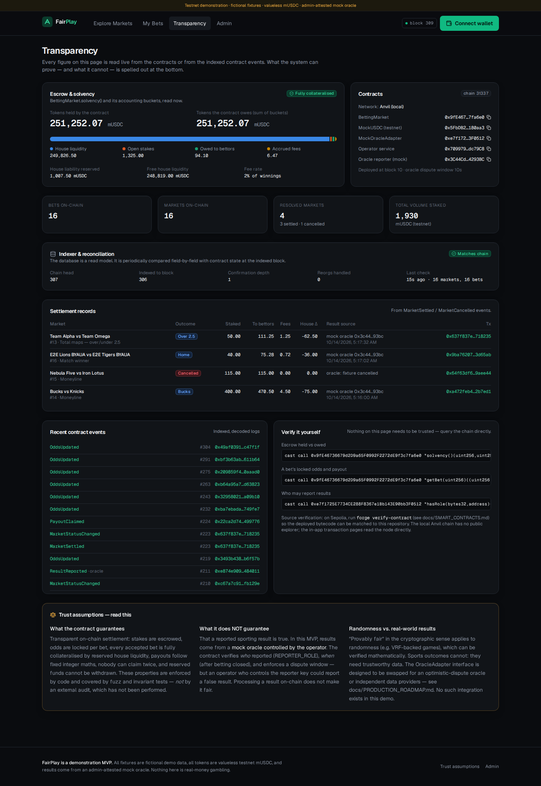 Transparency · live solvency · trust assumptions |
| 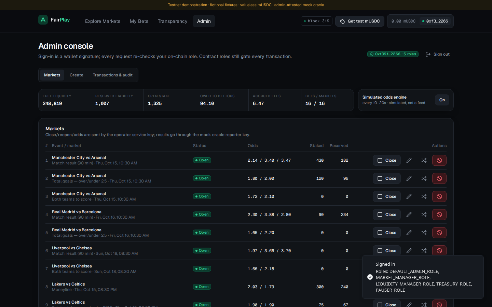 Admin console · signed actions · audit log | 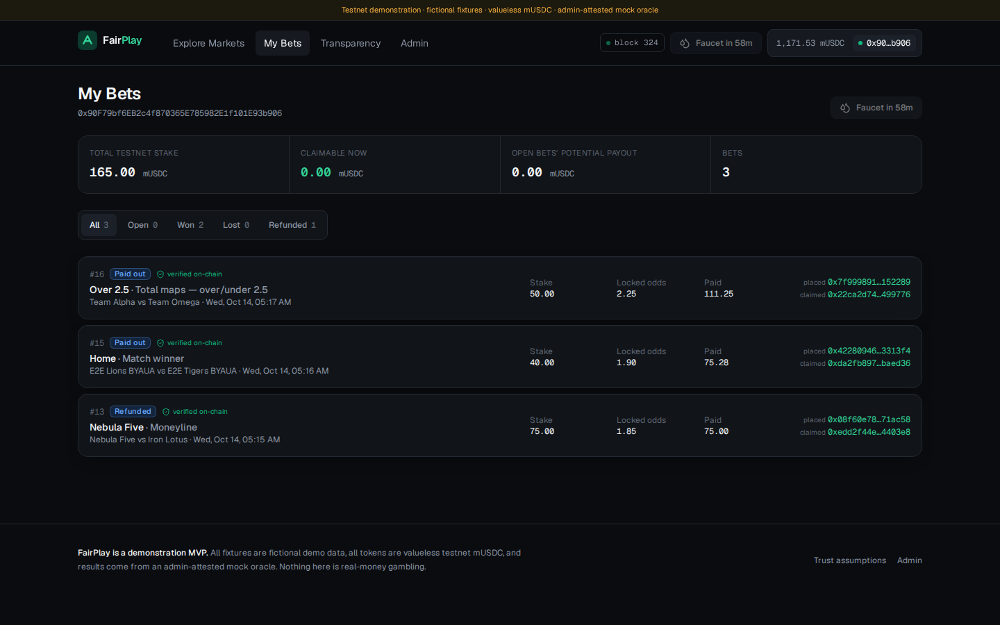 My Bets · claims |

Mobile layout: [docs/images/mobile.png](docs/images/mobile.png). All images are of this application running locally.

---

## Engineering quality

| Suite | Command | Result (2026-10-14) |
|---|---|---|
| Smart contracts — unit, fuzz, reentrancy, review regressions, deploy-script guards, invariants | `cd packages/contracts && forge test` | **66 passed** |
| Smart contracts — deep profile (5,000 fuzz runs; invariants 512 runs × 256 depth) | `FOUNDRY_PROFILE=ci forge test` | **66 passed** |
| API integration — real Anvil + real PostgreSQL (auth, replay, roles, indexer, **reorg**, WebSockets, network config) | `pnpm --filter @fairplay/api test` | **41 passed** |
| Shared integer maths | `pnpm --filter @fairplay/shared test` | **9 passed** |
| Browser E2E — core flow, admin controls, wallet behaviour (Playwright, real chain) | `pnpm test:e2e` | **19 passed** |
| Browser E2E — Sepolia build on a local Sepolia fork | `E2E_NETWORK=sepolia-fork pnpm test:e2e` | **6 passed** (rehearsal) |
| Scripted 3-minute demo, verified on-chain | `pnpm demo:flow` | **9/9 steps** |
| Real MetaMask, manual | see Proof above | ✅ |

- `BettingMarket.sol` coverage: 96 % lines, 68 % branches. Slither: no High/Medium findings ([triage](docs/SECURITY.md)).
- The automated wallet suites use a **clearly-labelled simulated EIP-1193 wallet**; real MetaMask was verified
  manually (above). WalletConnect has not been tested with a real wallet.
- CI ([workflow](.github/workflows/ci.yml)) runs contracts, typecheck + integration tests + web build, and the
  Playwright suite on every push. See the badge at the top for the live status.

## Tech stack

| Layer | Technologies |
|---|---|
| Smart contracts | Solidity 0.8.28 · Foundry · OpenZeppelin 5.4 (AccessControl, ReentrancyGuard, Pausable, SafeERC20) |
| Backend | Node 22 · TypeScript · Fastify 5 · Prisma 7 / PostgreSQL 16 · Socket.IO · Zod · Pino · viem |
| Frontend | Next.js 16 · React 19 · Tailwind 4 · Radix/shadcn-style UI · wagmi 2 · RainbowKit · TanStack Query · Zustand · Recharts · Framer Motion |
| Quality & ops | Vitest · Playwright · Slither · Docker Compose · GitHub Actions |

## Run it yourself

**One command (Docker):**

```bash
docker compose up --build          # → http://localhost:3600
```

**Local toolchain** (Node 22.12+, pnpm 9, Foundry 1.5, Docker for Postgres):

```bash
pnpm install
pnpm env:init                      # .env for the local chain (public Anvil dev keys only)
pnpm demo:setup                    # chain + DB + deploy + seed 8 fictional events + index
scripts/stack.sh start             # API :4600 · web :3600
pnpm demo:flow                     # optional: the 9-step demo, verified on-chain
```

Connect with **"Anvil dev · Demo bettor"** (no extension needed — the local node signs, no key in the browser), or
use MetaMask with network RPC `http://127.0.0.1:8565`, chain id 31337.

| Guide | |
|---|---|
| [DEMO_GUIDE.md](docs/DEMO_GUIDE.md) | 3-minute walkthrough |
| [CLIENT_DEMO_CHECKLIST.md](docs/CLIENT_DEMO_CHECKLIST.md) | pre-recording checklist, reset, troubleshooting |
| [SEPOLIA_DEPLOYMENT.md](docs/SEPOLIA_DEPLOYMENT.md) | testnet deployment procedure (fork-rehearsed) |

## Documentation

| Doc | Contents |
|---|---|
| [ARCHITECTURE.md](docs/ARCHITECTURE.md) | components, data flows, indexer design, data model |
| [SMART_CONTRACTS.md](docs/SMART_CONTRACTS.md) | lifecycle, liquidity model & invariants, roles, tests, bugs found |
| [SECURITY.md](docs/SECURITY.md) | trust assumptions, controls, review findings, Slither triage, residual risks |
| [PRODUCTION_ROADMAP.md](docs/PRODUCTION_ROADMAP.md) | audit, licensing, KYC/AML, responsible gambling, oracles, disputes, monitoring, governance |

## Honest limitations

- **Results are trusted, not verified:** the mock oracle is controlled by the operator. The contract enforces
  *who* reported, *when*, and a dispute window — not *truth*. Production needs an independent/optimistic oracle.
- A market manager can cancel (refund) a market until a valid result is final — a documented trust assumption.
- Simulated odds, fictional fixtures, valueless token; no KYC/AML, geo-restriction or responsible-gambling controls.
- No external audit; a single API instance runs the keeper and odds engine; no load testing.
- Not deployed to a public network yet; WalletConnect untested with a real wallet; mobile verified in a headless
  browser, not on devices.

## Repository layout

```
apps/web            Next.js frontend · Playwright suites (apps/web/e2e)
apps/api            Fastify API · indexer · reconciler · keeper · odds engine · Vitest integration tests
packages/contracts  Foundry project — BettingMarket, MockOracleAdapter, MockUSDC, tests, deploy script
packages/shared     generated ABIs · integer odds maths · Zod schemas · DTO types
scripts             env-init · demo-setup · demo-flow · sepolia · stack.sh
docs                architecture · contracts · security · guides · roadmap · screenshots
```

## Keys and secrets

No real secrets are in this repository. `.env.example` and `.env.sepolia.example` contain placeholders; the only
keys present (`.env.docker`, tests, scripts) are **Anvil's publicly-known development keys**, which the deploy
script, API and Sepolia preflight refuse on any network other than the local chain.

---

<div align="center">
<sub>Built by <a href="https://github.com/pranay123-stack">pranay123-stack</a> · Solidity libraries vendored from official tagged releases (forge-std v1.11.0, OpenZeppelin v5.4.0) · third-party install scripts disabled</sub>
</div>
